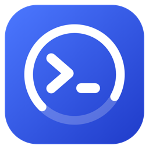
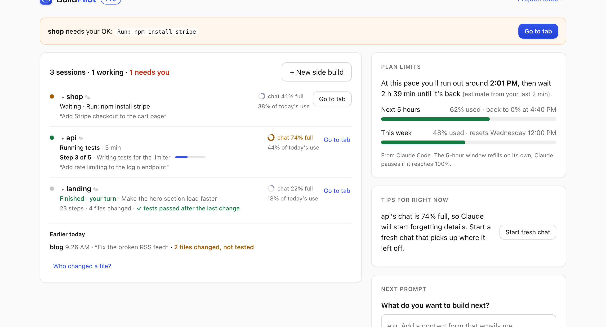

<p align="center"></p>
<h1 align="center">BuildPilot: your Claude Code companion</h1>
<p align="center"><b>Know what Claude is doing. Know when it needs you. Know what to do next.</b><br>A Claude Code plugin, with an optional window and Mac menu-bar widget · local-only · works across many sessions</p>
<p align="center"><a href="https://matchappai.github.io/buildpilot/">Website</a> · <a href="#install">Install</a> · <a href="docs/COMPARISON.md">How it compares</a></p>
<p align="center"></p>

Made for people who build with Claude Code, from first-time vibe coders to developers running five sessions at once.

- **What is Claude doing?** Every Claude Code session across your projects, needs-you first: *"Running tests · 4 min"*, the exact command waiting for your OK, and what you asked. When Claude keeps a checklist you see **"Step 3 of 7 · Adding login"**.
- **Is it stuck, failing or waiting?** Needs your OK, needs an answer, your turn, stopped mid-task, may be stuck (one step running too long), real errors only (not every `grep` that found nothing). One notification per moment, even with the window, VS Code and the menu bar all open.
- **Finished vs verified.** "Claude finished" isn't proof. Each request shows steps, files changed and whether tests passed **after** the last change: *✓ tests passed*, *✗ tests failing* or *not tested yet*.
- **Worth a look.** BuildPilot flags risky steps it saw: force-push, `git reset --hard`, `rm -rf` on a real folder, edits to `.env`, and tests that were failing, got edited, then passed.
- **Chat health and cost.** Chat % full (amber at 70%, red at 90%) with **Start fresh** on the row, compaction alerts, the starting token load and what eats it, 5-hour and weekly limits with *"at this pace you'll run out around 5:47 PM"*. API users see spend for today only.
- **Go to tab.** Every row jumps to that session's Terminal, iTerm or tmux tab.
- **Your day:** `bp today` / `/bp-today`: needs you, stuck, working, check before you trust it, what finished, one next step.
- **Side builds:** **+ New side build → Review → Merge** runs another Claude in its own copy of the project so sessions can't undo each other's work.
- **Prompt box:** plain words in, an expert prompt out.

Everything stays on your computer. [How it compares](docs/COMPARISON.md) · [Privacy](docs/SECURITY.md)

## Install

BuildPilot is a helper for **Claude Code**. You don't need VS Code or any other editor. Two ways to use it:

- **A. Plugin only:** everything works inside Claude Code and your terminal (`/bp`, `/bp-today`, `bp ui`).
- **B. Plugin + Mac widget:** adds the menu-bar widget with notifications and an optional floating panel (`bp bar install`).

**1. Inside Claude Code** (one time):

```
/plugin marketplace add MatchappAI/buildpilot
/plugin install buildpilot@buildpilot
```

**2. Open it:**
- `/bp-ui` in Claude Code, or `bp ui` in a terminal, opens BuildPilot in its own window.
- On a Mac, the **BuildPilot** app on your Desktop does the same: double-click.
- In Claude Code, `/bp` shows your sessions, limits and tips; `/bp-today` your day; `/bp-doctor` checks the setup and repairs what's safe. Also `/bp-new <name>`, `/bp-merge <name>`, `/bp-prompt <idea>`, `/bp-connect` (exact chat % and limits) and `/bp-license <key>`.
- **Menu bar (Mac):** `bp bar install`. Its gear menu has **Floating panel**: a small panel that never takes focus (compact: the one session that matters, expanded: all of them), with **Keep on top** as a separate choice.

**Update:** `/plugin update buildpilot`, then `bp doctor --fix` once. **Uninstall:** `/plugin uninstall buildpilot` (plus `bp hooks uninstall`, `bp statusline uninstall` and `bp bar uninstall` if you used them; each restores exactly what was there).

**Needs:** Node.js 18+ on your PATH (22.13+ recommended). Claude Code's own installer doesn't include Node; get it from [nodejs.org](https://nodejs.org). Without it, BuildPilot tells you in one line.

**Works best on a Mac.** Windows and Linux are a preview: builds, limits, tips, prompts and Review/Merge work, and Resume/New build open Windows Terminal (or a cmd window) or your Linux terminal. "Go to tab", notifications and the menu-bar widget are Mac only.

**Terminal:** run `/bp-terminal` once in Claude Code to add the `bp` command to your terminal (zsh/bash). Then: `bp ui` · `bp today` · `bp doctor` · `bp limits` · `bp new "<name>"` · `bp review` / `bp merge <name>` · `bp go` (jump to the build that needs you) · `bp who <file>` · `bp builds` / `bp done <name>` · `bp tmux` (status segment) · `bp prompt auto "<idea>"` · `bp help`

*Optional:* if you also work in VS Code or Cursor, the same page can sit beside your terminal there (`dist/buildpilot.vsix`).

## Free and Pro

| Free forever | Pro, $5/mo, cancel anytime |
|---|---|
| Builds and what needs you · chat % full · plan limits, reset times **and when you'll run out** · limit alerts · tips with one-click fixes · Start fresh chat · Turn on undo · terminal, plugin and menu bar · 20 prompts · 2 builds at once, with Review & Merge | As many builds at once as you like, each reviewed and merged from the page · your tests run automatically before every merge · which build is using your limit · unlimited prompts |

Everyone gets a **14-day Pro trial**. Nothing is ever blocked before Pro is on sale. Pro is separate from your Claude plan. After checkout, the thank-you page shows your key. Paste it with **BuildPilot: Enter License Key** or `bp license <key>`.

## Privacy, in one paragraph

**Connect** adds hooks and a status-line reporter to `~/.claude/settings.json`. You see the exact lines first ("See exactly what changes"), your settings are backed up, and **Disconnect** removes exactly those lines. Hooks copy each Claude Code event to `~/.buildpilot/spool`. BuildPilot then:
- reads the events
- redacts secrets
- stores a short log: tool names, commands, file names and errors, but no file contents
- deletes the copies
- keeps the log at most 30 days

Nothing is uploaded. There's no telemetry unless you say yes to a one-time question (4 anonymous counts, with a random ID used only for that).

## Develop

`npm run build` · `npm run typecheck` · `npm run lint` · `npm test` · `npm run test:smoke` · `npm run ci` · `npm run package` · `npm run desktop`

- `src/core`: the engine, with no vscode imports. That includes `page.ts`, `tips.ts`, `license.ts` and `counts.ts`.
- `src/extension`: the VS Code glue and the page panel.
- `src/webview`: the page itself.
- `src/cli.ts`: the `bp` command.
- `plugin/`: the Claude Code plugin. The marketplace file is `.claude-plugin/marketplace.json`.
- `server/`: the license Worker (Stripe → signed key).

More: [docs/](docs/), with [PUBLISHING.md](docs/PUBLISHING.md) for the steps that need your accounts.

## What BuildPilot can't see (honest limits)

- **Only what Claude Code reports.** It reads Claude Code's documented hooks and status line. Edits made with shell commands (`sed`, scripts) don't count as "files changed"; tests count only when Claude runs them in a session (or you run them from BuildPilot).
- **Chat % and plan limits** appear after the status-line reporter is on and Claude has replied once. Before that they show as unknown, never guessed.
- **Checklist progress** appears only when Claude keeps a to-do list in that session.
- **Go to tab** finds Terminal, iTerm and tmux on a Mac; two sessions in the same folder may pick the wrong tab.
- **Remote / web sessions** (claude.ai/code) don't run local hooks, so they don't appear.
